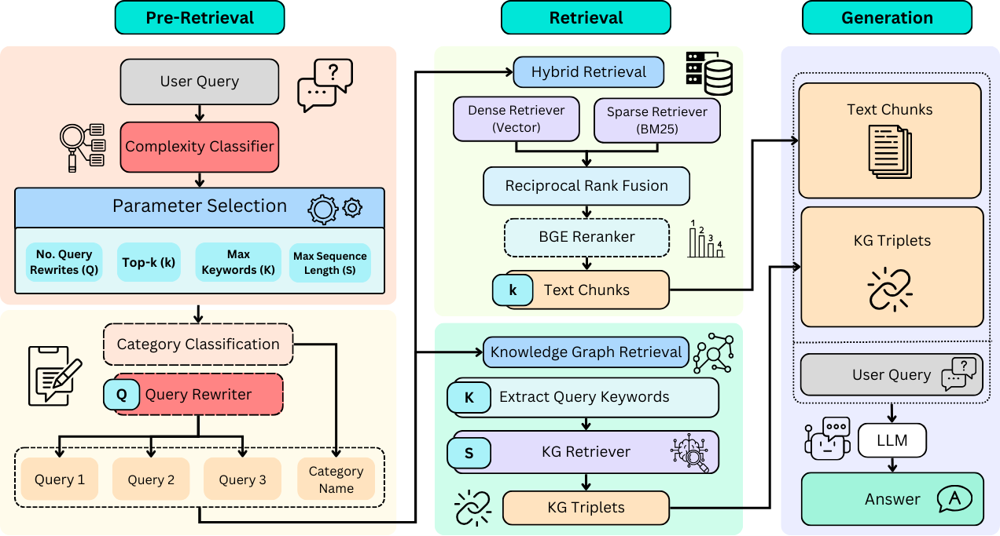

# HyPA-RAG

A hybrid parameter-adaptive retrieval-augmented generation (RAG) system for AI legal and policy questions, built with [Holistic AI](https://www.holisticai.com/) and University College London.

- Paper: [NAACL 2025 Industry Track](https://aclanthology.org/2025.naacl-industry.79/) and [arXiv:2409.09046](https://arxiv.org/abs/2409.09046)
- Also presented at the [EMNLP 2024 CustomNLP4U Workshop](https://customnlp4u-24.github.io/accepted/)
- Project page: [rk68.github.io/projects/hypa-rag.html](https://rk68.github.io/projects/hypa-rag.html)

> [!NOTE]
> This is research code from 2024, kept as it was for the paper. It is not maintained. The live demo on Hugging Face Spaces is no longer supported. The demo app code stays in `exp3/hf-demo/` for reference.



## What it does

Language models answer legal and policy questions poorly when their knowledge is out of date, or when the law mixes qualitative rules with numeric thresholds. Retrieval helps, but one fixed retrieval setup either misses context on hard questions or wastes tokens on easy ones. HyPA-RAG adapts its retrieval to each question. We tested it on New York City Local Law 144 (LL144), which regulates automated employment decision tools.

1. **Pre-retrieval.** A fine-tuned DistilBERT classifier rates how complex the question is. The rating sets the retrieval parameters: the number of query rewrites (Q), the top-k chunks (k), the maximum knowledge graph keywords (K) and the maximum knowledge sequence length (S).
2. **Retrieval.** Dense (vector) and sparse (BM25) retrieval run together, and reciprocal rank fusion merges their results. A BGE reranker orders the chunks. A knowledge graph built from GPT-4o triplets adds facts that plain chunks miss.
3. **Generation.** The language model answers from the text chunks and the knowledge graph triplets.

## Results

On LL144, parameter-adaptive retrieval beat every fixed top-k setting. Selected rows from Table 2 of the paper:

| Method | Faithfulness | Answer relevancy | Absolute correctness (1 to 5) | Correctness (threshold 4.0) |
|---|---|---|---|---|
| GPT-4o-mini only, no retrieval | 0.3463 | 0.6319 | 3.3494 | 0.4572 |
| Fixed k = 10 | 0.8480 | **0.7917** | 4.0595 | 0.7658 |
| PA: k, Q (2 class) | **0.9044** | 0.7910 | 4.2491 | 0.8104 |
| PA: k, Q (3 class) | 0.8971 | 0.7778 | **4.2528** | **0.8141** |
| HyPA: k, Q, K, S (3 class) | 0.8465 | 0.7734 | 4.1338 | 0.7918 |

PA is parameter-adaptive retrieval without the knowledge graph. HyPA adds the knowledge graph. In the ablation study, HyPA with a query rewriter and a reranker reached the highest correctness score, 0.8402. The complexity classifier reached a macro F1 score of 0.90 on 3 classes and 0.92 on 2 classes.

## Repository layout

| Folder | Contents |
|---|---|
| `eval_and_data/legal_data/` | Source documents: LL144 and the EU AI Act, as PDF |
| `eval_and_data/giskard_test_sets/` | Generated question and answer test sets for LL144 and the EU AI Act |
| `eval_and_data/notebooks/` | Test set generation and correctness evaluation |
| `exp1/` | Experiment 1: chunking methods, chunk sizes, embedding models and metadata, with results |
| `exp2/` | Experiment 2: the query complexity classifier, its training data and its results |
| `exp3/code/` | Experiment 3: the HyPA-RAG system, its retrievers and the evaluation scripts |
| `exp3/results/` | Experiment 3 results for the adaptive, hybrid and knowledge graph configurations |
| `exp3/hf-demo/` | The Streamlit app for the former Hugging Face demo |

## Running the code

The code needs these services:

- Azure OpenAI deployments of GPT-3.5 Turbo, GPT-4o and GPT-4o-mini
- Neo4j for the knowledge graph
- Pinecone for the vector index

The scripts read their keys from a `.env` file. They use these variables: `AZURE_OPENAI_API_KEY`, `AZURE_OPENAI_ENDPOINT`, `AZURE_API_VERSION`, `AZURE_DEPLOYMENT_NAME`, `GPT4O_API_KEY`, `GPT4O_AZURE_ENDPOINT`, `GPT4O_API_VERSION`, `GPT4O_DEPLOYMENT_NAME`, `GSK_AZURE_OPENAI_API_KEY`, `GSK_AZURE_OPENAI_ENDPOINT`, `NEO4J_URI`, `NEO4J_USERNAME`, `NEO4J_PASSWORD`, `NEO4J_DATABASE` and `PINECONE_API_KEY`.

```sh
cd exp3/code
pip install -r requirements.txt

# Build the indexes for one corpus: LL144 or EUAIACT
python load_docs.py --corpus LL144 --index_type vector --database pinecone
python load_docs.py --corpus LL144 --index_type kg --database neo4j

# Run an evaluation. Pass the test set path, because the default path is out of date.
python run_eval.py --test_set_path ../../eval_and_data/giskard_test_sets/LL144/LL144_275_New.jsonl \
  --results_base_path ../results/my_run --kg_index --rewriter --device cpu
```

The dependencies are pinned to mid-2024 versions of LlamaIndex, LangChain and Giskard. Newer versions may not work without changes.

## Citation

```bibtex
@inproceedings{kalra-etal-2025-hypa,
    title = "{H}y{PA}-{RAG}: A Hybrid Parameter Adaptive Retrieval-Augmented Generation System for {AI} Legal and Policy Applications",
    author = "Kalra, Rishi and Wu, Zekun and Gulley, Ayesha and Hilliard, Airlie and Guan, Xin and Koshiyama, Adriano and Treleaven, Philip Colin",
    booktitle = "Proceedings of the 2025 Conference of the Nations of the {A}mericas Chapter of the {A}ssociation for {C}omputational {L}inguistics: Human Language Technologies (Volume 3: Industry Track)",
    month = apr,
    year = "2025",
    address = "Albuquerque, New Mexico",
    publisher = "Association for Computational Linguistics",
    url = "https://aclanthology.org/2025.naacl-industry.79/",
    doi = "10.18653/v1/2025.naacl-industry.79",
    pages = "1036--1054"
}
```
